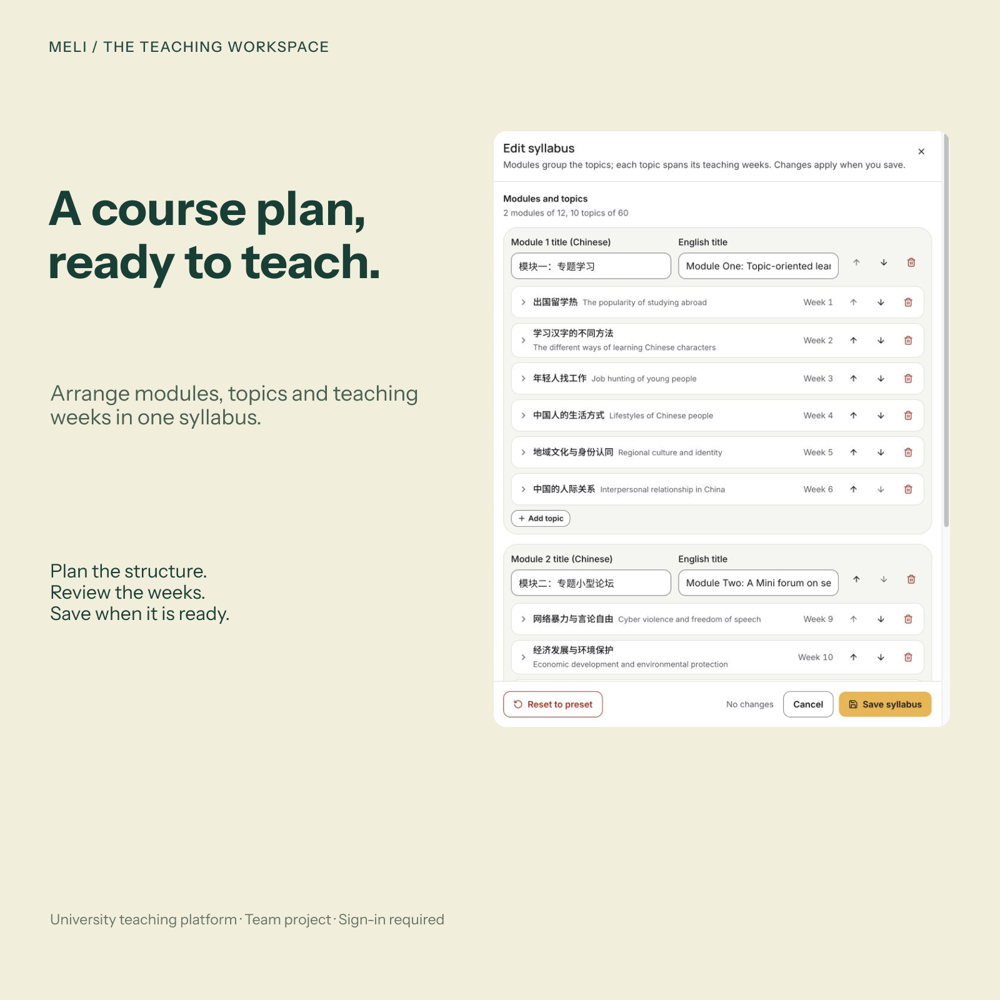
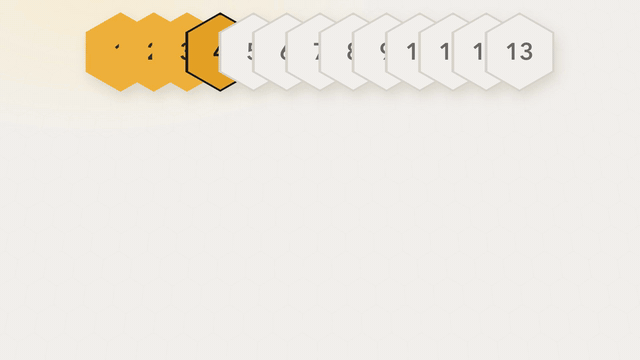
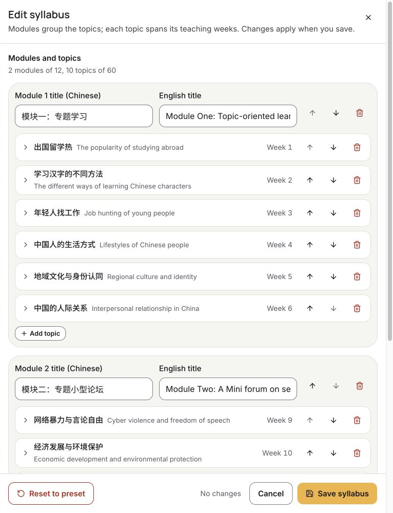
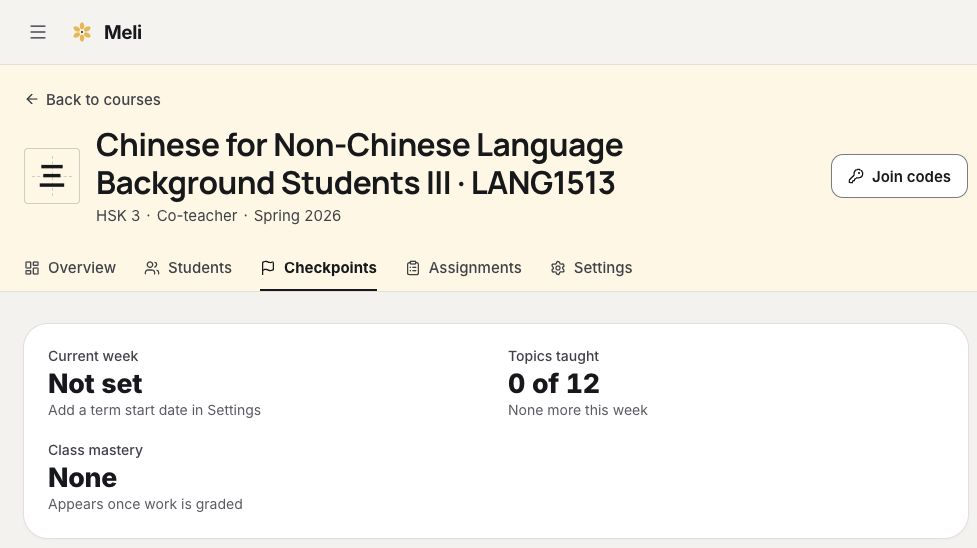

<strong>MELI</strong>

<h1 align="center">Bring the course into view.</h1>

Course materials, practice and progress in one teaching workspace.

<a href="#from-the-course-to-the-next-task">Explore the experience</a> · <a href="https://cle-meli.hkust.edu.hk">Institutional sign-in</a> · <a href="#my-work-with-the-team">My contribution</a>

## Watch the product film

[Watch the full film (MP4)](assets/meli-promo-20261024.mp4) · [Open the still frame](assets/meli-promo-20261024-poster.png) · [Capture and production details](assets/meli-promo-20261024-manifest.json)

University team project with institutional sign-in. The film uses demo-data screens of released components, with no real students, plus a privacy-reviewed production syllabus crop, all captured in October 2026. The teacher reviews a question and its score policy before publishing; the film does not show questions being generated.

## Give the next lesson a place in the course

A language class moves between explanations, exercises and feedback. MELI connects those pieces to a course structure, so a teacher can organise the next activity and a learner can see where to begin.

### Start with the whole term

The syllabus workspace groups topics into modules and connects them to teaching weeks and assessment milestones. The plan makes the relationship between today's activity and the wider course visible.

Inspect the syllabus-planning screen

Captured on 23 October 2026. This crop isolates the planning panel and excludes student identities and assessment data. The syllabus was inspected without changing or saving it.

## From the course to the next task

**Prepare the course.** Organise topics and learning materials around what needs to be taught.

**Move into practice.** Give the learner activities and topic checkpoints within that structure.

**Return to progress.** Review what has been covered and decide what needs attention next.

AI supports these teaching workflows within the course. The teacher's purpose and review guide what the system is meant to help with.

## My work with the team

MELI is a team project. My contributions include learning workflows, assessment materials, analysis and university sign-in integration.

The work connects educational requirements with the interface and the system behind it: how a topic is organised, how an activity fits the course and how people reach the workspace. Those connections are part of building a teaching tool that has to make sense beyond a single screen.

[Explore the project organisation](https://github.com/Meliedu) · [Read my contribution notes](https://github.com/EricEremos/EricEremos/blob/main/work/README.md#meli)

## Access and project status

MELI is an institutional course platform; access to the live workspace requires sign-in. This public showcase presents the course-platform work, while the implementation, authenticated services and student records remain private.

About the captures

The planning interface was captured from production on 23 October 2026. The course-workspace capture is dated 21 October 2026. Student identities and individual records are excluded from both. The hero campaign was curated in Figma around the original planning interface; select it to view the original crop.

This showcase describes my contributions to a team project and does not represent institutional endorsement.

---

[More projects by Hyunjun Kim](https://github.com/EricEremos) · [Get in touch](https://www.linkedin.com/in/ericmos/)
